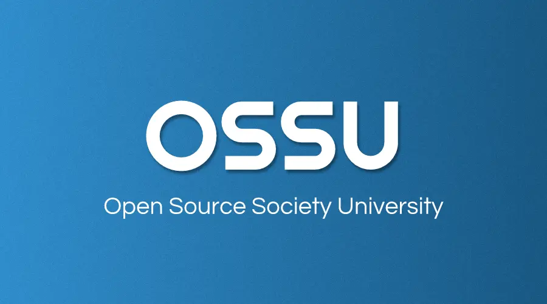
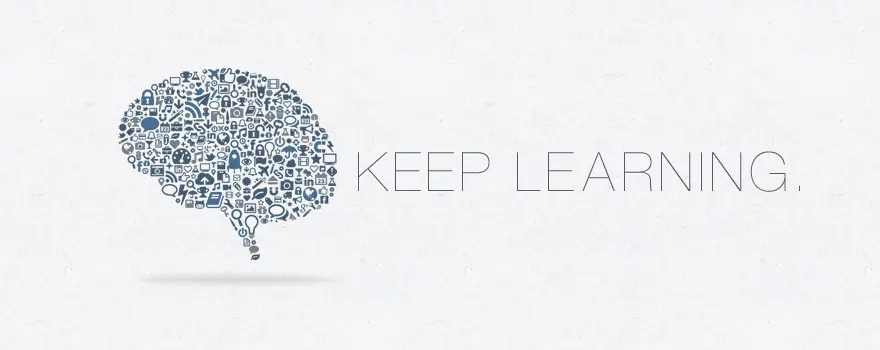

<h3>Open Source Society University</h3>

  ¡Camino hacia una educación gratuita y autodidacta en Ciencias de la Computación!

  
  

# Contenido

- [Resumen](#resumen)
- [Comunidad](#comunidad)
- [Curriculum](#curriculum)
- [Código de conducta](#código-de-conducta)
- [Equipo](#equipo)

# Resumen

El plan de estudios de OSSU es una **educación completa en ciencias de la computación** que utiliza materiales en línea.
No se trata solo de formación profesional o de desarrollo de carrera.
Está dirigido a quienes desean una base sólida y *completa* en conceptos fundamentales para todas las disciplinas de la computación,
y a quienes tienen la disciplina, la voluntad y (¡lo más importante!) los buenos hábitos para obtener esta educación en su mayoría por sí mismos,
pero con el apoyo de una comunidad mundial de otros estudiantes.

Está diseñado según los requisitos de titulación de las carreras de pregrado en ciencias de la computación, sin los requisitos de educación general (no relacionados con CS),
ya que se asume que la mayoría de las personas que siguen este plan de estudios ya tienen formación fuera del campo de CS.
Los cursos en sí están entre los mejores del mundo, a menudo provienen de Harvard, Princeton, MIT, etc.,
pero se eligen específicamente para cumplir los siguientes criterios.

**Los cursos deben**:
- Estar abiertos a inscripciones
- Ofrecerse regularmente (idealmente a ritmo propio, de lo contrario ofrecerse varias veces al año)
- Tener una calidad generalmente alta en materiales de enseñanza y principios pedagógicos
- Ajustarse a los estándares curriculares de [CS 2013](CURRICULAR_GUIDELINES.md): Curriculum Guidelines for Undergraduate Degree Programs in Computer Science

Cuando ningún curso cumple los criterios anteriores, el trabajo del curso se complementa con un libro.
Cuando hay cursos o libros que no encajan en el plan de estudios pero que de otro modo son de alta calidad,
pertenecen a [extras/courses](extras/courses.md) o [extras/readings](extras/readings.md).

**Organización**. El plan de estudios está diseñado de la siguiente manera:
- *Intro CS*: para que los estudiantes prueben CS y vean si es lo adecuado para ellos
- *Core CS*: corresponde aproximadamente a los primeros tres años de una carrera de ciencias de la computación, tomando clases que todos los estudiantes estarían obligados a cursar
- *Advanced CS*: corresponde aproximadamente al último año de una carrera de ciencias de la computación, tomando materias optativas según los intereses del estudiante
- *Final Project*: un proyecto para que los estudiantes validen, consoliden y muestren sus conocimientos, evaluado por sus pares en todo el mundo

**Duración**. Es posible terminar en aproximadamente 2 años si planificas con cuidado y dedicas alrededor de 20 horas/semana a tus estudios. Los estudiantes pueden usar [esta hoja de cálculo](https://docs.google.com/spreadsheets/d/1y2kMsIg9VaHMVmw35x_aH1hpty3V-ZMuV2jA13P_Cgo/copy) para estimar su fecha de finalización. Haz una copia e ingresa tu fecha de inicio y las horas semanales previstas en la hoja `Timeline`. A medida que avanzas en los cursos, puedes registrar las fechas reales de finalización de cada curso en la hoja `Curriculum Data` y obtener estimaciones de finalización actualizadas.
  
> **Advertencia:** Aunque la hoja de cálculo es una herramienta útil para estimar el tiempo que necesitas para completar este plan de estudios, puede no estar siempre actualizada con el currículo. Usa el [sitio web de OSSU CS](https://cs.ossu.dev) o [el repositorio](https://github.com/ossu/computer-science) para ver qué cursos tomar.

**Costo**. Todo o casi todo el material del curso está disponible de forma gratuita. Sin embargo, algunos cursos pueden cobrar por la evaluación de tareas/exámenes/proyectos.
Ten en cuenta que tanto [Coursera](https://www.coursera.support/s/article/209819033-Apply-for-Financial-Aid-or-a-Scholarship?language=en_US) como [edX](https://courses.edx.org/financial-assistance/) ofrecen ayuda financiera.

Decide cuánto gastar o no según tu tiempo y presupuesto;
¡solo recuerda que el éxito no se puede comprar!

**Proceso**. Los estudiantes pueden avanzar en el plan de estudios solos o en grupos, siguiendo el orden indicado o no.
- Recomendamos hacer todos los cursos de Core CS, saltando un curso solo cuando estés seguro de que ya aprendiste ese material anteriormente.
- Por simplicidad, recomendamos avanzar en los cursos (especialmente Core CS) en orden de arriba hacia abajo. Algunos estudiantes eligen estudiar varios cursos a la vez para variar el material con el que trabajan en un día/semana. Una opción popular es tomar los cursos de matemáticas en paralelo con los cursos introductorios. Los prerrequisitos de cada curso se listan para ayudarte a determinar si estás preparado para un curso determinado.
- Los cursos de Advanced CS son optativos. Elige un tema (por ejemplo, Advanced programming) en el que quieras convertirte en experto y toma todos los cursos bajo ese encabezado. También puedes crear tu propio tema personalizado; la comunidad de Discord puede darte comentarios sobre el tema que planeas.

**Política de contenido**. Si planeas mostrar públicamente parte de tu trabajo en los cursos, solo debes compartir los archivos que tienes permitido compartir.
¡*Respeta el código de conducta* que firmaste al comienzo de cada curso!

**[Cómo contribuir](CONTRIBUTING.md)**

**[Obtener ayuda](HELP.md)** (Detalles sobre nuestro FAQ y sala de chat)

# Comunidad

- ¡Tenemos un servidor de Discord!  Este debería ser tu primer punto de contacto para hablar con otros estudiantes de OSSU. ¿Por qué no te presentas ahora mismo? [Únete al Discord de OSSU](https://discord.gg/wuytwK5s9h)
- También puedes interactuar a través de los issues de GitHub. Si hay un problema con un curso o es necesario hacer un cambio en el plan de estudios, este es el lugar para iniciar la conversación. Lee más [aquí](CONTRIBUTING.md).
- Agrega **Open Source Society University** a tu perfil de [Linkedin](https://www.linkedin.com/school/11272443/).

> **Advertencia:** Existen algunos materiales de terceros/obsoletos/desactualizados que podrías encontrar al buscar OSSU. Te recomendamos ignorarlos y usar solo el [sitio web de OSSU CS](https://cs.ossu.dev) o el [repositorio de Github de OSSU CS](https://github.com/ossu/computer-science). Algunos materiales desactualizados conocidos son:
>  - Una app de Firebase sin mantenimiento y en desuso. Lee más en el [FAQ](./FAQ.md#por-qué-la-app-de-ossu-en-firebase-es-diferente-o-está-rota).
>  - Un tablero de Trello sin mantenimiento y en desuso
>  - Plantillas de Notion de terceros

# Curriculum

- [Prerrequisitos](#prerrequisitos)
- [Intro CS](#intro-cs)
- [Core CS](#core-cs)
  - [Core programming](#core-programming)
  - [Core math](#core-math)
  - [CS Tools](#cs-tools)
  - [Core systems](#core-systems)
  - [Core theory](#core-theory)
  - [Core security](#core-security)
  - [Core applications](#core-applications)
  - [Core ethics](#core-ethics)
- [Advanced CS](#advanced-cs)
  - [Advanced programming](#advanced-programming)
  - [Advanced systems](#advanced-systems)
  - [Advanced theory](#advanced-theory)
  - [Advanced information security](#advanced-information-security)
  - [Advanced math](#advanced-math)
- [Final project](#final-project)

---

## Prerrequisitos

- [Core CS](#core-cs) asume que el estudiante ya cursó [matemáticas de bachillerato](https://ossu.dev/precollege-math), incluyendo álgebra, geometría y precálculo.
- [Advanced CS](#advanced-cs) asume que el estudiante ya completó la totalidad de Core CS
y que ahora tiene los conocimientos suficientes para decidir qué optativas tomar.
- Ten en cuenta que [Advanced systems](#advanced-systems) asume que el estudiante ha cursado un curso básico de física (por ejemplo, AP Physics en el bachillerato).

## Intro CS

Este curso te introducirá al mundo de las ciencias de la computación y la programación. El curso te da una muestra del material que vendrá. Si terminas el curso queriendo más, ¡las ciencias de la computación probablemente son para ti!

**Temas cubiertos**:
`computación`
`programación imperativa`
`estructuras de datos y algoritmos básicos`
`y más`

Cursos | Duración | Dedicación | Prerrequisitos | Discusión
:-- | :--: | :--: | :--: | :--:
[Introduction to Computer Science and Programming using Python](coursepages/intro-cs/README.md) | 14 semanas | 6-10 horas/semana | [álgebra de bachillerato](https://ossu.dev/precollege-math) | [chat](https://discord.gg/jvchSm9)

## Core CS

Todo el trabajo de cursos bajo Core CS es **obligatorio**, salvo que se indique lo contrario.

### Core programming
**Temas cubiertos**:
`programación funcional`
`diseño para pruebas`
`requisitos de programas`
`patrones de diseño comunes`
`pruebas unitarias`
`diseño orientado a objetos`
`tipado estático`
`tipado dinámico`
`lenguajes de la familia ML (mediante Standard ML)`
`lenguajes de la familia Lisp (mediante Racket)`
`Ruby`
`y más`

Cursos | Duración | Dedicación | Prerrequisitos | Discusión
:-- | :--: | :--: | :--: | :--:
[Systematic Program Design](coursepages/spd/README.md) | 13 semanas | 8-10 horas/semana | - | chat: [part 1](https://discord.gg/RfqAmGJ) / [part 2](https://discord.gg/kczJzpm)
[Class-based Program Design](coursepages/class-based/README.md) | 13 semanas | 5-10 horas/semana | Systematic Program Design, matemáticas de bachillerato | [chat](https://discord.com/channels/744385009028431943/891411727294562314)
[Programming Languages](https://courses.cs.washington.edu/courses/cse341/19sp/#lectures) | 11 semanas | 4-8 horas/semana | Systematic Program Design | [chat](https://discord.gg/8BkJtXN)
[Object-Oriented Design](https://course.ccs.neu.edu/cs3500f19/) | 13 semanas | 5-10 horas/semana | Class-based Program Design | [chat](https://discord.com/channels/744385009028431943/891412022120579103)
[Software Architecture](https://www.coursera.org/learn/software-architecture) | 4 semanas | 2-5 horas/semana | Object Oriented Design | [chat](https://discord.com/channels/744385009028431943/891412169638432788)

### Core math
Las matemáticas discretas (Math for CS) son un prerrequisito y están estrechamente relacionadas con el estudio de algoritmos y estructuras de datos. El cálculo prepara a los estudiantes para las matemáticas discretas y les ayuda a desarrollar madurez matemática.

**Temas cubiertos**:
`matemáticas discretas`
`demostraciones matemáticas`
`estadística básica`
`notación O`
`probabilidad discreta`
`y más`

Cursos | Duración | Dedicación | Notas | Prerrequisitos | Discusión
:-- | :--: | :--: | :--: | :--: | :--:
[Calculus 1A: Differentiation](https://openlearninglibrary.mit.edu/courses/course-v1:MITx+18.01.1x+2T2019/about) ([alternative](https://ocw.mit.edu/courses/mathematics/18-01sc-single-variable-calculus-fall-2010/index.htm)) | 13 semanas | 6-10 horas/semana | La alternativa cubre este curso y los 2 siguientes | [matemáticas de bachillerato](https://ossu.dev/precollege-math) | [chat](https://discord.gg/mPCt45F)
[Calculus 1B: Integration](https://openlearninglibrary.mit.edu/courses/course-v1:MITx+18.01.2x+3T2019/about) | 13 semanas | 5-10 horas/semana | - | Calculus 1A | [chat](https://discord.gg/sddAsZg)
[Calculus 1C: Coordinate Systems & Infinite Series](https://openlearninglibrary.mit.edu/courses/course-v1:MITx+18.01.3x+1T2020/about) | 6 semanas | 5-10 horas/semana | - | Calculus 1B | [chat](https://discord.gg/FNEcNNq)
[Mathematics for Computer Science](https://openlearninglibrary.mit.edu/courses/course-v1:OCW+6.042J+2T2019/about) ([alternative](https://ocw.mit.edu/courses/6-042j-mathematics-for-computer-science-fall-2010/)) | 13 semanas | 5 horas/semana | [soluciones 2015/2019](https://github.com/spamegg1/Math-for-CS-solutions) [soluciones 2010](https://github.com/frevib/mit-cs-math-6042-fall-2010-problems) [soluciones 2005](https://ocw.mit.edu/courses/electrical-engineering-and-computer-science/6-042j-mathematics-for-computer-science-fall-2005/assignments/). | Calculus 1C | [chat](https://discord.gg/EuTzNbF)

### CS Tools
Entender la teoría es importante, pero también se espera que crees programas. Existen varias herramientas que se usan ampliamente para facilitar ese proceso. Apréndelas ahora para simplificar tu futuro trabajo al escribir programas.

**Temas cubiertos**:
`terminales y scripting de shell`
`vim`
`entornos de línea de comandos`
`control de versiones`
`y más`

Cursos | Duración | Dedicación | Prerrequisitos | Discusión
:-- | :--: | :--: | :--: | :--:
[The Missing Semester of Your CS Education](https://missing.csail.mit.edu/) | 2 semanas | 12 horas/semana | - | [chat](https://discord.gg/5FvKycS)

### Core systems

**Temas cubiertos**:
`programación procedural`
`gestión manual de memoria`
`álgebra booleana`
`lógica de puertas`
`memoria`
`arquitectura de computadoras`
`ensamblador`
`lenguaje de máquina`
`máquinas virtuales`
`lenguajes de alto nivel`
`compiladores`
`sistemas operativos`
`protocolos de red`
`y más`

Cursos | Duración | Dedicación | Texto adicional / Tareas| Prerrequisitos | Discusión
:-- | :--: | :--: | :--: | :--: | :--:
[Build a Modern Computer from First Principles: From Nand to Tetris](https://www.coursera.org/learn/build-a-computer) ([alternative](https://www.nand2tetris.org/)) | 6 semanas | 7-13 horas/semana | - | lenguaje de programación tipo C | [chat](https://discord.gg/vxB2DRV)
[Build a Modern Computer from First Principles: Nand to Tetris Part II](https://www.coursera.org/learn/nand2tetris2) | 6 semanas | 12-18 horas/semana | - | uno de [estos lenguajes de programación](https://user-images.githubusercontent.com/2046800/35426340-f6ce6358-026a-11e8-8bbb-4e95ac36b1d7.png), From Nand to Tetris Part I | [chat](https://discord.gg/AsUXcPu)
[Operating Systems: Three Easy Pieces](coursepages/ostep/README.md) | 10-12 semanas | 6-10 horas/semana | - | Nand to Tetris Part II | [chat](https://discord.gg/wZNgpep)
[Computer Networking: a Top-Down Approach](https://gaia.cs.umass.edu/kurose_ross/online_lectures.htm)| 8 semanas | 4–12 horas/semana | [Wireshark Labs](https://gaia.cs.umass.edu/kurose_ross/wireshark.php) | álgebra, probabilidad, fundamentos de CS | [chat](https://discord.gg/MJ9YXyV)

### Core theory

**Temas cubiertos**:
`dividir y conquistar`
`ordenamiento y búsqueda`
`algoritmos aleatorios`
`búsqueda en grafos`
`caminos más cortos`
`estructuras de datos`
`algoritmos golosos`
`árboles generadores mínimos`
`programación dinámica`
`NP-completitud`
`y más`

Cursos | Duración | Dedicación | Prerrequisitos | Discusión
:-- | :--: | :--: | :--: | :--:
[Algorithms: Design and Analysis, Part 1](https://www.edx.org/learn/algorithms/stanford-university-algorithms-design-and-analysis-part-1) ([alternative](https://www.algorithmsilluminated.org/)) | 8 semanas | 4-8 horas/semana | cualquier lenguaje de programación, Mathematics for Computer Science | [chat](https://discord.gg/mKRS7tY)
[Algorithms: Design and Analysis, Part 2](https://www.edx.org/learn/algorithms/stanford-university-algorithms-design-and-analysis-part-2) | 8 semanas | 4-8 horas/semana | Algorithms Part 1 | [chat](https://discord.gg/Qstqe4t)

### Core security
**Temas cubiertos**
`Confidencialidad, Integridad, Disponibilidad`
`Diseño seguro`
`Programación defensiva`
`Amenazas y ataques`
`Seguridad de redes`
`Criptografía`
`y más`

Cursos | Duración | Dedicación | Prerrequisitos | Discusión
:-- | :--: | :--: | :--: | :--:
[Cybersecurity Fundamentals](https://www.edx.org/learn/cybersecurity/rochester-institute-of-technology-cybersecurity-fundamentals) | 8 semanas | 10-12 horas/semana | - | [chat](https://discord.gg/XdY3AwTFK4)
[Principles of Secure Coding](https://www.coursera.org/learn/secure-coding-principles)| 4 semanas | 4 horas/semana | - | [chat](https://discord.gg/5gMdeSK)
[Identifying Security Vulnerabilities](https://www.coursera.org/learn/identifying-security-vulnerabilities) | 4 semanas | 4 horas/semana | - | [chat](https://discord.gg/V78MjUS)

Elige **uno** de los siguientes:

Cursos | Duración | Dedicación | Prerrequisitos | Discusión
:-- | :--: | :--: | :--: | :--:
[Identifying Security Vulnerabilities in C/C++ Programming](https://www.coursera.org/learn/identifying-security-vulnerabilities-c-programming) | 4 semanas | 5 horas/semana | - | [chat](https://discord.gg/Vbxce7A)
[Exploiting and Securing Vulnerabilities in Java Applications](https://www.coursera.org/learn/exploiting-securing-vulnerabilities-java-applications) | 4 semanas | 5 horas/semana | - | [chat](https://discord.gg/QxC22rR)

### Core applications

**Temas cubiertos**:
`metodología ágil`
`REST`
`especificaciones de software`
`refactorización`
`bases de datos relacionales`
`procesamiento de transacciones`
`modelado de datos`
`redes neuronales`
`aprendizaje supervisado`
`aprendizaje no supervisado`
`OpenGL`
`trazado de rayos`
`y más`

Cursos | Duración | Dedicación | Prerrequisitos | Discusión
:-- | :--: | :--: | :--: | :--:
[Databases: Modeling and Theory](https://www.edx.org/learn/databases/stanford-university-databases-modeling-and-theory)| 2 semanas | 10 horas/semana | core programming | [chat](https://discord.gg/pMFqNf4)
[Databases: Relational Databases and SQL](https://www.edx.org/learn/relational-databases/stanford-university-databases-relational-databases-and-sql)| 2 semanas | 10 horas/semana | core programming | [chat](https://discord.gg/P8SPPyF)
[Databases: Semistructured Data](https://www.edx.org/learn/relational-databases/stanford-university-databases-semistructured-data)| 2 semanas | 10 horas/semana | core programming | [chat](https://discord.gg/duCJ3GN)
[Machine Learning](https://www.deeplearning.ai/courses/machine-learning-specialization/)| 11 semanas | 9 horas/semana | programación básica | [chat](https://discord.gg/NcXHDjy)
[Computer Graphics](https://www.edx.org/learn/computer-graphics/the-university-of-california-san-diego-computer-graphics) ([alternative](https://cseweb.ucsd.edu/~viscomp/classes/cse167/wi22/schedule.html))| 6 semanas | 12 horas/semana | C++ o Java, [Álgebra lineal básica](https://ossu.dev/precollege-math/coursepages/precalculus) | [chat](https://discord.gg/68WqMNV)
[Software Engineering: Introduction](https://www.edx.org/learn/software-engineering/university-of-british-columbia-software-engineering-introduction) ([alternative](https://github.com/ubccpsc/310/blob/main/resources/README.md)) | 6 semanas | 8-10 horas/semana | Core Programming y un [proyecto de gran envergadura](FAQ.md#por-qué-se-requiere-experiencia-en-un-proyecto-de-gran-envergadura-antes-de-los-cursos-de-ingeniería-de-software) | [chat](https://discord.gg/5Qtcwtz)

### Core ethics

**Temas cubiertos**:
`Contexto social`
`Herramientas analíticas`
`Ética profesional`
`Propiedad intelectual`
`Privacidad y libertades civiles`
`y más`

Cursos | Duración | Dedicación | Prerrequisitos | Discusión
:-- | :--: | :--: | :--: | :--:
[Ethics, Technology and Engineering](https://www.coursera.org/learn/ethics-technology-engineering)| 9 semanas | 2 horas/semana | - | [chat](https://discord.gg/6ttjPmzZbe)
[Introduction to Intellectual Property](https://www.coursera.org/learn/introduction-intellectual-property)| 4 semanas | 2 horas/semana | - | [chat](https://discord.gg/YbuERswpAK)
[Data Privacy Fundamentals](https://www.coursera.org/learn/northeastern-data-privacy)| 3 semanas | 3 horas/semana | - | [chat](https://discord.gg/64J34ajNBd)

## Advanced CS

Después de completar **todos los cursos obligatorios** de Core CS, los estudiantes deben elegir un subconjunto de cursos de Advanced CS según sus intereses.
No es necesario tomar todos los cursos de una subcategoría.
Pero los estudiantes deben tomar *todos* los cursos que sean relevantes para el campo al que piensan dedicarse.

### Advanced programming

**Temas cubiertos**:
`teoría y práctica de la depuración`
`programación orientada a metas`
`computación paralela`
`análisis y diseño orientado a objetos`
`UML`
`arquitectura y diseño de software a gran escala`
`y más`

Cursos | Duración | Dedicación | Prerrequisitos
:-- | :--: | :--: | :--:
[Parallel Programming](https://www.coursera.org/learn/scala-parallel-programming)| 4 semanas | 6-8 horas/semana | programación en Scala
[Compilers](https://www.edx.org/learn/computer-science/stanford-university-compilers) | 9 semanas | 6-8 horas/semana | -
[Introduction to Haskell](https://www.seas.upenn.edu/~cis194/fall16/)| 14 semanas | - | -
[Learn Prolog Now!](https://www.let.rug.nl/bos/lpn//lpnpage.php?pageid=online) ([alternative](https://github.com/ossu/computer-science/files/6085884/lpn.pdf))*| 12 semanas | - | -
[Software Debugging](https://www.youtube.com/playlist?list=PLAwxTw4SYaPkxK63TiT88oEe-AIBhr96A)| 8 semanas | 6 horas/semana | Python, programación orientada a objetos
[Software Testing](https://www.youtube.com/playlist?list=PLAwxTw4SYaPkWVHeC_8aSIbSxE_NXI76g) | 4 semanas | 6 horas/semana | Python, experiencia en programación

(*) libro de Blackburn, Bos, Striegnitz (compilado a partir del [código fuente](https://github.com/LearnPrologNow/lpn), redistribuido bajo la [licencia CC](https://creativecommons.org/licenses/by-sa/4.0/))

### Advanced systems

**Temas cubiertos**:
`señalización digital`
`lógica combinacional`
`tecnologías CMOS`
`lógica secuencial`
`máquinas de estados finitos`
`conjuntos de instrucciones del procesador`
`cachés`
`pipelining`
`virtualización`
`procesamiento paralelo`
`memoria virtual`
`primitivas de sincronización`
`interfaz de llamadas al sistema`
`y más`

Cursos | Duración | Dedicación | Prerrequisitos | Notas
:-- | :--: | :--: | :--: | :--:
[Computation Structures 1: Digital Circuits](https://learning.edx.org/course/course-v1:MITx+6.004.1x_3+3T2016) [alternative 1](https://ocw.mit.edu/courses/6-004-computation-structures-spring-2017/) [alternative 2](https://ocw.mit.edu/courses/6-004-computation-structures-spring-2009/) | 10 semanas | 6 horas/semana | [Nand2Tetris II](https://www.coursera.org/learn/nand2tetris2) | Los enlaces alternativos contienen los 3 cursos.
[Computation Structures 2: Computer Architecture](https://learning.edx.org/course/course-v1:MITx+6.004.2x+3T2015) | 10 semanas | 6 horas/semana | Computation Structures 1 | - 
[Computation Structures 3: Computer Organization](https://learning.edx.org/course/course-v1:MITx+6.004.3x_2+1T2017) | 10 semanas | 6 horas/semana | Computation Structures 2 | -

### Advanced theory

**Temas cubiertos**:
`lenguajes formales`
`máquinas de Turing`
`computabilidad`
`concurrencia basada en eventos`
`autómatas`
`memoria compartida distribuida`
`algoritmos de consenso`
`replicación de máquinas de estados`
`teoría de geometría computacional`
`lógica proposicional`
`lógica relacional`
`lógica de Herbrand`
`árboles de juego`
`y más`

Cursos | Duración | Dedicación | Prerrequisitos
:-- | :--: | :--: | :--:
[Theory of Computation](https://ocw.mit.edu/courses/18-404j-theory-of-computation-fall-2020/) ([alternative](https://www.youtube.com/playlist?list=PLEE7DF8F5E0203A56)) | 13 semanas | 10 horas/semana | [Mathematics for Computer Science](https://openlearninglibrary.mit.edu/courses/course-v1:OCW+6.042J+2T2019/about), lógica, algoritmos
[Computational Geometry](https://www.edx.org/learn/geometry/tsinghua-university-ji-suan-ji-he-computational-geometry) | 16 semanas | 8 horas/semana | algoritmos, C++
[Algorithmic Game Theory](https://timroughgarden.org/f13/f13.html) | 10 semanas | 12 horas/semana | Core Theory

### Advanced Information Security

Cursos | Duración | Dedicación | Prerrequisitos
:-- | :--: | :--: | :--:
[Web Security Fundamentals](https://www.edx.org/learn/computer-security/ku-leuven-web-security-fundamentals) | 5 semanas | 4-6 horas/semana | comprensión de tecnologías web básicas
[Security Governance & Compliance](https://www.coursera.org/learn/security-governance-compliance) | 3 semanas | 3 horas/semana | -
[Digital Forensics Concepts](https://www.coursera.org/learn/digital-forensics-concepts) | 3 semanas | 2-3 horas/semana | Core Security
[Secure Software Development: Requirements, Design, and Reuse](https://www.edx.org/learn/software-development/the-linux-foundation-secure-software-development-requirements-design-and-reuse) | 7 semanas | 1-2 horas/semana | Core Programming y Core Security
[Secure Software Development: Implementation](https://www.edx.org/learn/software-development/the-linux-foundation-secure-software-development-implementation) | 7 semanas | 1-2 horas/semana | Secure Software Development: Requirements, Design, and Reuse
[Secure Software Development: Verification and More Specialized Topics](https://www.edx.org/learn/software-engineering/the-linux-foundation-secure-software-development-verification-and-more-specialized-topics) | 7 semanas | 1-2 horas/semana | Secure Software Development: Implementation

### Advanced math

Cursos | Duración | Dedicación | Prerrequisitos | Discusión
:-- | :--: | :--: | :--: | :--:
[Essence of Linear Algebra](https://www.youtube.com/playlist?list=PLZHQObOWTQDPD3MizzM2xVFitgF8hE_ab) | - | - | [matemáticas de bachillerato](https://ossu.dev/precollege-math) | [chat](https://discord.gg/m6wHbP6)
[Linear Algebra](https://ocw.mit.edu/courses/mathematics/18-06sc-linear-algebra-fall-2011/) | 14 semanas | 12 horas/semana | correlativo: Essence of Linear Algebra | [chat](https://discord.gg/k7nSWJH)
[Introduction to Numerical Methods](https://ocw.mit.edu/courses/mathematics/18-335j-introduction-to-numerical-methods-spring-2019/index.htm)| 14 semanas | 12 horas/semana | [Linear Algebra](https://ocw.mit.edu/courses/mathematics/18-06sc-linear-algebra-fall-2011/) | [chat](https://discord.gg/FNEcNNq)
[Introduction to Formal Logic](https://forallx.openlogicproject.org/) | 10 semanas | 4-8 horas/semana | [Set Theory](https://www.youtube.com/playlist?list=PL5KkMZvBpo5AH_5GpxMiryJT6Dkj32H6N) | [chat](https://discord.gg/MbM2Gg5)
[Probability](https://stat110.hsites.harvard.edu/) | 15 semanas | 5-10 horas/semana | [Differentiation and Integration](https://www.edx.org/course/calculus-1b-integration) | [chat](https://discord.gg/UVjs9BU)

## Final project

Parte de aprender es hacer.
Las tareas y exámenes de cada curso están diseñados para prepararte a usar tus conocimientos para resolver problemas del mundo real.

Después de haber completado Core CS y las partes de Advanced CS que son relevantes para ti,
deberías identificar un problema que puedas resolver con los conocimientos que has adquirido.
Puedes crear algo completamente nuevo, o mejorar alguna herramienta/programa que uses y que desearas que fuera mejor.

Los estudiantes que deseen más orientación para crear un proyecto pueden optar por usar una serie de cursos enfocados en proyectos.
Aquí hay una muestra de opciones
(hay muchas más disponibles; en este punto deberías ser capaz de identificar una serie que sea interesante y relevante para ti):

Cursos | Duración | Dedicación | Prerrequisitos
:-- | :--: | :--: | :--:
[Fullstack Open](https://fullstackopen.com/en/) | 12 semanas | 15 horas/semana | programación
[Modern Robotics](https://modernrobotics.northwestern.edu) | 26 semanas | 2-5 horas/semana | física de nivel introductorio, álgebra lineal, cálculo, [ecuaciones diferenciales ordinarias lineales](https://www.khanacademy.org/math/differential-equations)
[Data Mining (Specialization)](https://www.coursera.org/specializations/data-mining) | 30 semanas | 2-5 horas/semana | aprendizaje automático
[Big Data (Specialization)](https://www.coursera.org/specializations/big-data) | 30 semanas | 3-5 horas/semana | -
[Internet of Things (Specialization)](https://www.coursera.org/specializations/internet-of-things) | 30 semanas | 1-5 horas/semana | programación sólida
[Cloud Computing (Specialization)](https://www.coursera.org/specializations/cloud-computing) | 30 semanas | 2-6 horas/semana | programación en C++
[Data Science (Specialization)](https://www.coursera.org/specializations/jhu-data-science) | 43 semanas | 1-6 horas/semana | -
[Functional Programming in Scala (Specialization)](https://www.coursera.org/specializations/scala) | 29 semanas | 4-5 horas/semana | Un año de experiencia en programación
[Game Design and Development with Unity 2020 (Specialization)](https://www.coursera.org/specializations/game-design-and-development) | 6 meses | 5 horas/semana | programación, diseño interactivo

## Felicitaciones

Después de completar los requisitos del plan de estudios anterior,
habrás completado el equivalente a una carrera de pregrado completa en Ciencias de la Computación.
¡Felicitaciones!

¿Qué sigue para ti? Las posibilidades son ilimitadas y se solapan entre sí:

- ¡Busca un trabajo como desarrollador!
- Revisa las [lecturas](extras/readings.md) para encontrar libros clásicos que puedas leer y que afilarán tus habilidades y ampliarán tus conocimientos.
- Únete a un meetup local de desarrolladores (por ejemplo, a través de [meetup.com](https://www.meetup.com/)).
- Presta atención a las tecnologías emergentes en el mundo del desarrollo de software:
  + Explora el **modelo de actores** a través de [Elixir](https://elixir-lang.org/), un nuevo lenguaje de programación funcional para la web basado en la probada Erlang Virtual Machine!
  + Explora **borrowing y lifetimes** a través de [Rust](https://www.rust-lang.org/), un lenguaje de sistemas que logra seguridad de memoria e hilos sin un recolector de basura!
  + Explora los **sistemas de tipos dependientes** a través de [Idris](https://www.idris-lang.org/), un nuevo lenguaje inspirado en Haskell con soporte sin precedentes para el desarrollo dirigido por tipos.

# Código de conducta
[Código de conducta de OSSU](https://github.com/ossu/code-of-conduct).

## Cómo mostrar tu progreso

[Haz un fork](https://www.freecodecamp.org/news/how-to-fork-a-github-repository/) del [repositorio de GitHub](https://github.com/ossu/computer-science) en tu propia cuenta de GitHub y pon ✅ junto a lo que vayas completando. Esto puede servir como tu [tablero kanban](https://en.wikipedia.org/wiki/Kanban_board) y será más rápido de implementar que cualquier otra solución (dejándote tiempo para dedicar a los cursos).

# Equipo

* **[Eric Douglas](https://github.com/ericdouglas)**: fundador de OSSU
* **[Josh Hanson](https://github.com/joshmhanson)**: responsable técnico principal
* **[Waciuma Wanjohi](https://github.com/waciumawanjohi)**: responsable académico principal
* **[Contribuyentes](https://github.com/ossu/computer-science/graphs/contributors)**
