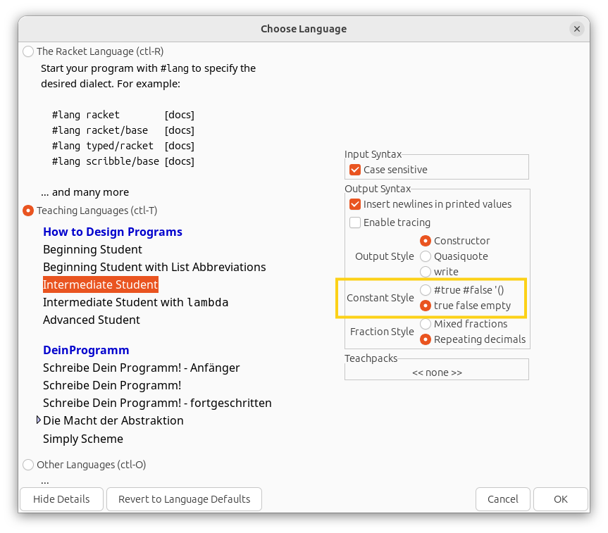
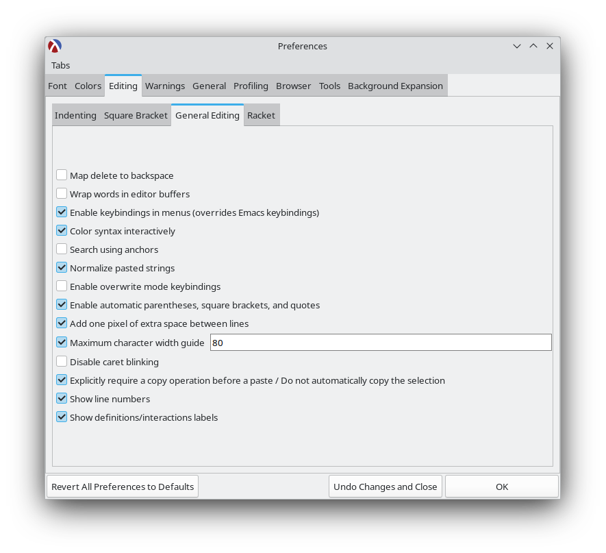

# Systematic Program Design

Este curso ha sido desarrollado por UBC y está disponible en Edx. Te recomendamos hacerlo desde la versión archivada en Edx.

> Este curso de programación adopta un enfoque único, ya que se centra en aprender un método de programación sistemático en lugar de un lenguaje de programación. Este enfoque práctico te ayudará a canalizar tu creatividad para que puedas programar bien en cualquier lenguaje.

**Enlace del curso (Recomendado):**

- <https://learning.edx.org/course/course-v1:UBCx+SPD1x+2T2015>
- <https://learning.edx.org/course/course-v1:UBCx+SPD2x+2T2015>
- <https://learning.edx.org/course/course-v1:UBCx+SPD3x+3T2015>

Enlaces alternativos:

- <https://www.edx.org/learn/coding/university-of-british-columbia-how-to-code-simple-data> (Hasta la Semana 6A)
- <https://www.edx.org/learn/coding/university-of-british-columbia-how-to-code-complex-data> (Desde la Semana 6B en adelante)

Consulta el FAQ de abajo para una explicación de las diferentes versiones del curso.

## Instrucciones

**Nota:** Estas instrucciones son para la versión archivada del curso en Edx, que es la que recomendamos. No aplican a otras versiones del curso.

- El curso no tiene una página de inicio en Edx, pero no te preocupes por eso. Abre el [enlace](https://learning.edx.org/course/course-v1:UBCx+SPD1x+2T2015) dado arriba, inicia sesión (si no lo has hecho) y luego inscríbete en el curso.
- Trabaja la Semana 1A hasta la Semana 6A según lo indicado en el resumen del curso. Mira los videos, haz los ejercicios y luego resuelve los problemas del banco de problemas.
- Después de completar la Semana 6A, completa el proyecto de space invaders con [estas instrucciones](./space-invaders-instructions.md).
- Luego, trabaja desde la Semana 6B en adelante. Mira los videos, haz los ejercicios y luego resuelve los problemas del banco de problemas.
- Después de eso, mira los videos extras de [esta lista de reproducción](https://www.youtube.com/playlist?list=PL6NenTZG6KrqdcyTwGf09uBxjI5pbXuT7).
- Cuando hayas completado todos los módulos del curso, haz el [TA solver problem](https://github.com/ossu/spd-starters/blob/main/final/ta-solver-starter.rkt). Encontrarás las instrucciones en el archivo inicial.
- La pestaña del banco de problemas tiene muchos problemas adicionales. Te sugerimos resolverlos todos para reforzar tu comprensión.
- Algunos enlaces a los archivos iniciales del curso ya no funcionan. Puedes descargar los archivos iniciales desde este repositorio de github: <https://github.com/ossu/spd-starters>. Puedes descargar un archivo zip con todos los archivos iniciales usando [este enlace](https://github.com/ossu/spd-starters/archive/refs/heads/main.zip).
- No podrás enviar tus respuestas para los ejercicios, pero puedes ver sus respuestas haciendo clic en "Show Answer". Revisa tus respuestas honestamente.
- No podrás enviar los problemas del banco de problemas, pero estos proporcionan soluciones de ejemplo. Puedes comparar tu solución con ellas.
- Aunque hay formas de hacer este curso en otros IDEs, te sugerimos usar Dr. Racket, ya que configurar los archivos iniciales de los problemas para otros IDEs no vale la pena. 
- Si te atascas en algún punto, no dudes en hacer preguntas. Puedes unirte al chat de OSSU para este curso aquí:
  - Chat para discusiones hasta la Semana 6A: <https://discord.gg/RfqAmGJ>
  - Chat para discusiones desde la Semana 6B en adelante: <https://discord.gg/kczJzpm>

## Notas

- Dr. Racket usa por defecto la notación más nueva `#true #false '()`. Puedes configurar Dr. Racket para que use la notación que usa el curso haciendo clic en la barra de menús en Language > Choose Language. Luego elige el lenguaje requerido (BSL, ISL u otras variantes). Luego haz clic en "Show details" en la parte inferior izquierda de la ventana. Luego elige `true false empty` en el campo "Constant Style". Ejecuta tu archivo de nuevo para asegurarte de que usa la nueva configuración.

- Puedes habilitar el cierre automático de paréntesis, corchetes y comillas. Haz clic en Edit en la barra de menús > Preferences > Go to Editing Tab > Go to General Editing Sub-tab > marca la casilla "Enable automatic parentheses, square brackets, and quotes".

- Puedes usar Ctrl + I para reindentar todo el archivo.

- Si estás en Windows o Linux, usa Alt + Backspace para borrar palabras completas.

- Si no puedes ver los videos en Edx por alguna razón, puedes verlos en [este canal de youtube](https://www.youtube.com/@systematicprogramdesign7962/playlists).

## FAQ

### Este curso es aburrido. ¿Puedo saltármelo?

**No.** Este curso puede parecer aburrido al principio, pero sugerimos trabajar en él. Es un gran curso, y probablemente cambiará la forma en que piensas. Muchos estudiantes que encontraron este curso aburrido al principio se convirtieron en fans del curso para cuando lo terminaron. Ten mucho cuidado. Las partes iniciales (especialmente las reglas sobre cómo funciona la evaluación) juegan un papel enorme en comprender cómo funciona el código y cómo se ejecuta durante el resto del curso.

### ¿Por qué este curso se enseña usando BSL? ¿No tendría más sentido enseñarlo en un lenguaje estándar de la industria?

Esta es una elección intencional, y esta es la razón:

1. Lisp es la lingua franca de los científicos de la computación -- a lo que nos referimos es de los investigadores de algoritmos con doctorado. Hay razones buenas y otras meramente históricas para esto, pero es un hecho de la vida; así que si quieres leer papers, vas a querer leer Lisp. BSL es una buena introducción, y francamente, una vez que superas el infierno de los paréntesis y una vez que conoces algún Lisp, sabes leerlos todos.

2. Este es el primer curso de ciencia de la computación en los currículos de la mayoría de las personas que no se centra en enseñarte a usar un lenguaje. Porque el punto de la ciencia de la computación no es enseñarte un lenguaje. Ni enseñarte a programar. Ni enseñarte a ser un ingeniero de software fullstack. La Ciencia de la Computación es una matemática aplicada de aplicación muy estrecha, con un uso práctico de amplio alcance.  Pero si eliminas todo el lenguaje calificativo, es matemática. Lo que significa que tiene ciertas reglas generales que son completamente, totalmente independientes de tu lenguaje de implementación.

Este curso está construido en un lenguaje de estudiante desechable, específicamente para que no te centres en el lenguaje y en cambio te centres en lo que estás haciendo con el lenguaje. No nos importa public static void main ni el estilo PEP8. Queremos ver formas de estructurar un programa en cualquier lenguaje. Así que no nos centramos en las cosas que hacen único a Java, ni en las cosas que hacen único a Python, y en cambio nos centramos en las cosas que hacen mejor al código.

Puede parecer duro aprender un nuevo lenguaje solo para tomar este curso, pero BSL te libera de tener que preocuparte por el linting de estilo, por los problemas de tiempo de ejecución, por la compartimentación del código, por la compilación o por el entorno de codificación. Es un regalo. Tómalo. Los patrones de diseño ya son suficientemente difíciles.

### ¿Por qué hay diferentes versiones del curso, HTC, SPD? ¿Por qué recomiendan la versión archivada?

Hay dos razones por las que la gente hace estos cursos:

- El conocimiento
- El certificado

OSSU asume que lo haces por el conocimiento. Puedes tenerlo gratis. Si lo haces por el conocimiento, no necesitas entregar tus tareas. Solo necesitas hacerlas.

Si quieres el reconocimiento de que hiciste el curso, entonces lo haces por el certificado. No puedes tener el certificado gratis. Tienes que pagar por él.

No hay razón para que entregues conjuntos de tareas a menos que lo hagas por el certificado -- Si lo estás haciendo, en realidad no puedes obtener un certificado del curso SPD (porque el curso ya expiró), así que estás en el lugar equivocado.

Si quieres un certificado, entonces necesitas tomar How To Code y necesitas pagar por él.

Pero no necesitas pagar nada en OSSU. Te sugerimos que tomes SPD porque el acceso a la información es mejor (porque el curso ya expiró) y es más que suficiente para obtener el conocimiento.

TL;DR:

    Si lo haces por el conocimiento, toma SPD -- es gratis pero inactivo
    Si lo haces por el certificado, toma y paga How To Code -- sigue siendo un curso activo

### ¿Puedo hacer este curso en otro lenguaje de programación?

Este curso está realmente integrado con los lenguajes de programación que usa. Te sugerimos usar el lenguaje especificado por el curso. Aunque los conceptos que aprendes de este curso son aplicables en cualquier parte, intentar hacer el curso con otro lenguaje no es realmente sensato y solo llevaría a una pérdida de tiempo.

### ¿Puedo usar otro IDE? No me gusta Dr. Racket.

Los programas de este curso incrustan imágenes y bloques de texto enriquecido en el código, lo que significa que los archivos no pueden ser abiertos por otros IDEs. Aunque es posible preparar los archivos iniciales para usarlos con otros IDEs, necesitas Dr. Racket para eso, y el tiempo necesario para hacerlo se puede aprovechar mejor en aprender los conceptos que enseña el curso.

### ¿Cómo pruebo funciones que deben producir valores aleatorios?

Puedes usar `check-random` para probar esas funciones. Puedes [aprender más sobre ello aquí](https://docs.racket-lang.org/htdp-langs/beginner-abbr.html#(form._((lib._lang%2Fhtdp-beginner-abbr..rkt)._check-random))). Es necesario para el proyecto de Space Invaders.

## Créditos

Los archivos iniciales de los problemas y las instrucciones de space invaders fueron tomados del curso ["Systematic Program Design" en Edx](https://learning.edx.org/course/course-v1:UBCx+SPD1x+2T2015), licenciado bajo la licencia [CC BY-NC-SA](https://creativecommons.org/licenses/by-nc-sa/4.0/).
